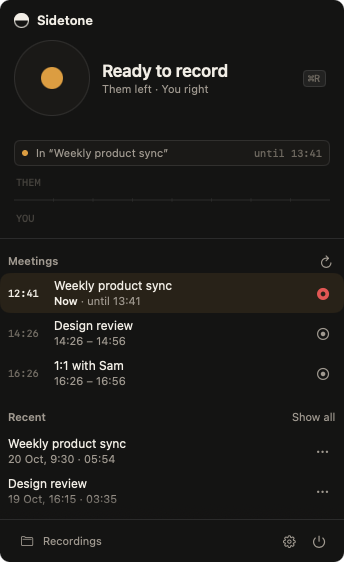
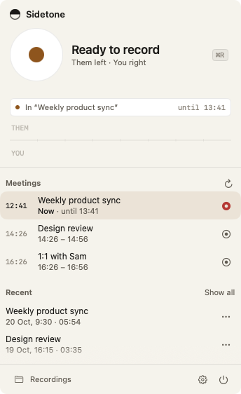
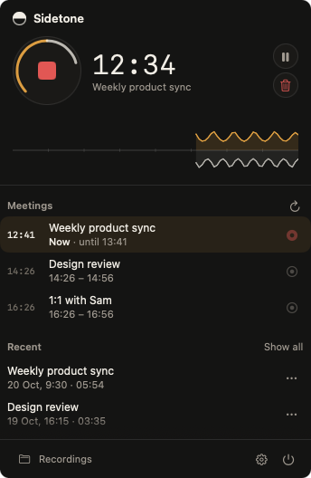
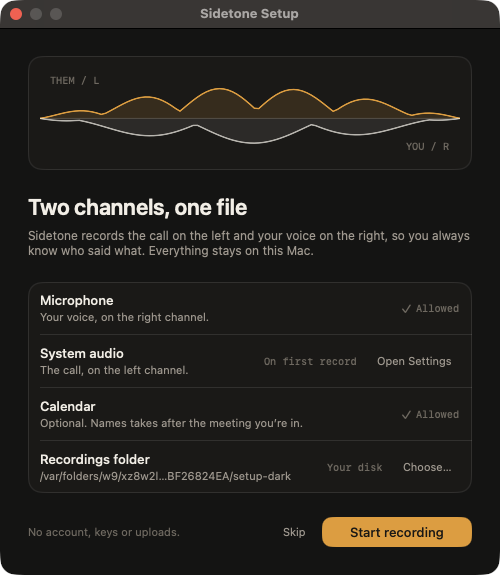

# Sidetone

A private, two-channel meeting recorder for macOS. One click in the menu bar records **the call on
the left channel** and **your voice on the right**, so you can always tell who said what.



No account, no API keys, no uploads. Everything stays on your Mac.

---

## Why two channels

Most recorders hand you one muddy mono mix. Sidetone hard-pans **system audio left** and **your
microphone right**, so the two sides stay cleanly separated:

- Mute or solo either side in any audio editor.
- Tell "who was on the call" from "who was in the room" at a glance.
- Trim one side without touching the other.

The app works the same way it looks: one amber button arms a take, the ring around it becomes a
live level meter for each channel, and the scope shows both signals while you record.

| Idle | Recording |
| --- | --- |
|  |  |

---

## Features

- **One-click record / pause / save / discard** from a compact menu-bar panel. `⌘R`, `⌘P`, `⌘,`, `⌘Q`.
- **Live two-channel scope** — desktop above the line, mic below, with the peak of each channel on
  the record ring.
- **Cleaner voice** — at mix time the mic gets a rumble filter, a gentle noise-floor expander and
  level matching, so quiet voices become audible without hiss. The raw captures are never altered.
- **A voice track for transcription** — every take also gets a mono, mic-only `.voice.m4a` beside
  the stereo mix, already cleaned and levelled. Feed that file to any transcription tool.
- **Calendar-aware** — nearby meetings are listed; recording during one names the take after it, and
  a notification offers **Stop Recording** when the meeting was scheduled to end.
- **Your folder, your files** — choose where recordings live in the first-run setup or in Settings.
  A finished take is a single `.m4a`; nothing else is written outside that folder.
- **Crash-safe** — each source streams to its own raw file continuously; quitting mid-recording
  saves it, and an unfinished mix can be rebuilt with **Mix now**.
- **Silence auto-stop** — ends a take after a configurable stretch of two-channel silence.
- **Mic optional** — record only the call, and the microphone is never opened.
- **System-audio watchdog** — rebuilds the Core Audio tap if macOS's known process-tap regression
  makes it go silent mid-recording.
- **Local-only by design** — no network code, no accounts, no keys, no telemetry.

Sidetone does **not** transcribe. It does produce the file transcription tools want: a mono,
clean, level-matched `.voice.m4a` next to the stereo mix.

---

## Requirements

- **macOS 15 or later.**
- **Swift 6.2 toolchain** (Xcode 26 or the matching Command Line Tools) to build.
  Xcode itself is not required: the package builds with `swift build`.

## Install

```sh
git clone https://github.com/MarioCodarin/Sidetone.git
cd Sidetone
./build.sh --install
```

`--install` builds a release binary, assembles `Sidetone.app`, ad-hoc signs it, replaces
`/Applications/Sidetone.app` and launches it. Without the flag, `./build.sh` only produces
`./Sidetone.app` in the repo.

The app is deliberately **non-sandboxed** (it needs system-audio capture and a user-chosen
recordings folder) and **ad-hoc signed**. Because TCC tracks the code signature, rebuilding with a
different signature can make macOS ask for permissions again. Set `CODESIGN_IDENTITY` to a stable
signing certificate if you rebuild often:

```sh
CODESIGN_IDENTITY="Apple Development: you@example.com" ./build.sh --install
```

---

## First run



The setup window asks for three things, and explains each one:

| Permission | Why | Required |
| --- | --- | --- |
| **Microphone** | Your voice, on the right channel. | Yes, unless you turn the mic off. |
| **System audio** | The call, on the left channel. Asked the first time you record. | Yes. |
| **Calendar** | Names takes after the meeting you're in. | No. |

It also lets you pick the **recordings folder** (default `~/Documents/Recordings`) and finishes with
**Start recording**. Closing the window counts as finishing; Settings → **Run setup again** reopens it.

There is no key to paste: Sidetone talks to no service. The only "credentials" it needs are the macOS
privacy grants, which are given in System Settings and can be revoked there at any time.

---

## Where your recordings go

While a take is in progress it is a working folder:

```
~/Documents/Recordings/2026-11-10-0930-Weekly-sync/
    desktop.caf     raw system audio, flushed continuously
    mic.caf         raw microphone, flushed continuously
    session.json    alignment data, used to re-mix after a crash
```

When the mix succeeds, the folder is replaced by the files next to it:

```
~/Documents/Recordings/2026-11-10-0930-Weekly-sync.m4a        stereo AAC, desktop = L, mic = R
~/Documents/Recordings/2026-11-10-0930-Weekly-sync.voice.m4a  mono AAC, the cleaned mic only
```

The voice track is only produced when the mic captured something, and can be turned off in
Settings → Voice.

The raw files are deleted only once that `.m4a` is a readable audio file. If the mix fails, the folder
stays and the panel offers **Mix now**. CAF (not WAV) is used for the raw files so a long meeting never
hits WAV's 4 GB ceiling.

The folder is yours: point it at an external drive, a synced folder, or anywhere else. Sidetone writes
nothing outside it, apart from its own preferences in `UserDefaults`.

---

## How it works

| Concern | Approach |
| --- | --- |
| **Desktop audio** | Core Audio **process tap** (`CATapDescription` + `AudioHardwareCreateProcessTap`) in a tap-only private aggregate device, driven by an IOProc. Needs *Audio Recording* — not Screen Recording. |
| **Microphone** | A separate `AVAudioEngine` input tap, created on Record and torn down on Stop, so Sidetone does not hold the mic while idle. |
| **Two captures, one file** | Each source streams to its own raw `.caf`; on Save they are aligned by first-buffer host time, resampled to 48 kHz, interleaved (L = desktop, R = mic) and encoded to AAC. |
| **Voice quality** | On Save, a `VoiceChain` levels the take to a consistent speech RMS, high-passes the rumble, gently expands the noise floor and soft-limits at -1 dBFS. The same pass writes the mono voice track. |
| **Realtime safety** | The IOProc only downmixes and `memcpy`s into a lock-free SPSC ring. A dedicated thread drains it to disk. No allocation, no locks shared with control code, no disk I/O on the audio thread. |
| **Meters** | Peaks are coalesced to 20 Hz on the main thread, so hundreds of audio callbacks per second cost two SwiftUI updates. |

More detail: [`docs/ARCHITECTURE.md`](docs/ARCHITECTURE.md).

---

## Project layout

```
Sources/SidetoneCore/        domain, ports (protocols), state machine — Foundation/Observation only
Sources/SidetoneAudio/       capture (system tap, mic), ring buffer, file writer, stereo mixer
Sources/SidetoneServices/    EventKit, notifications, permissions, AppKit actions, folder picker
Sources/Sidetone/            the menu-bar app: composition root + app delegate
Sources/SidetoneUI/          SwiftUI views and the design system (Support/Design.swift)
Tests/SidetoneCheck/         hardware-free checks (`swift run SidetoneCheck`)
Tests/SidetonePreview/       dev tool: renders the real views to PNGs (light + dark)
Assets/                      icon source (`icon.svg`) and the built `Sidetone.icns`
docs/                        architecture and screenshots
```

## Development

```sh
swift run SidetoneCheck          # 244 hardware-free checks: no devices, no network, no XCTest
swift run SidetonePreview out/   # screenshot every panel/setup/settings state, light + dark
./make-icon.sh                   # rebuild Assets/Sidetone.icns from Assets/icon.svg (needs librsvg)
./build.sh --install             # release build + install into /Applications
```

Command Line Tools ship neither XCTest nor the Swift Testing macros, which is why the checks are a
plain executable. See [`CONTRIBUTING.md`](CONTRIBUTING.md) for the module rules.

---

## Privacy

- **No network code.** Sidetone never contacts a server, so there is nothing to sign in to and no key
  to paste.
- **No account, no telemetry, no analytics.**
- Recordings live only in the folder you choose; the app reads that folder to list recent takes.
- While capturing, macOS shows the purple audio-capture privacy indicator — that is the system
  telling you the tap is live, not an upload.

If you find a security or privacy issue, see [`SECURITY.md`](SECURITY.md).

---

## Limitations

- Two channels, one file: there is no per-app audio splitting and no built-in transcription.
- Noise reduction is deliberately gentle. It removes rumble and steady room tone; it does not
  invent speech that the microphone did not pick up. On speakers the mic can still pick up the
  room, and headphones give the cleanest separation.
- Ad-hoc signing means a rebuild can reset the macOS privacy grants.

## License

[MIT](LICENSE).
